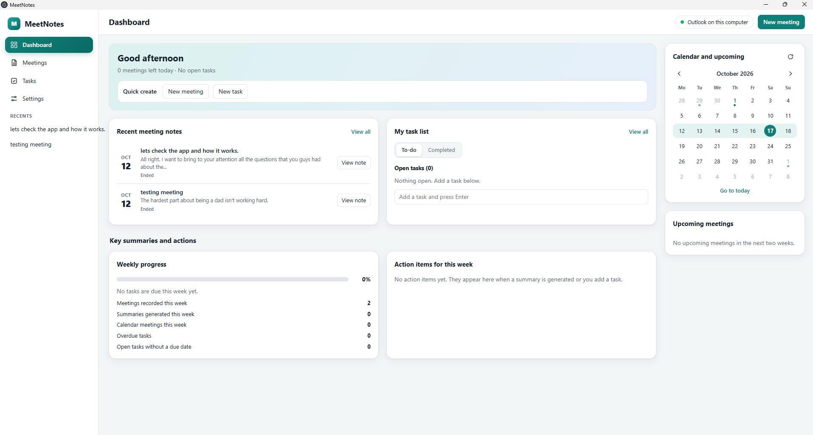

# MeetNotes v1.4.0

Personal Windows desktop app that tracks a meeting, transcribes it locally, keeps your notes, and generates a summary, action items and an after-meeting agenda with Claude, Codex, OpenAI or any AI tool you paste into.

## Setup (Windows 10 or 11)

1. Install Node.js 22 or newer from nodejs.org.
2. Unzip this folder anywhere.
3. Double-click `start.bat`. The first run installs dependencies, which takes a few minutes. Or run `npm install` then `npm start` in a terminal.
4. Open Settings, choose an AI connection under AI summary, and press Test AI connection. See "AI summary connections" below.
5. Optional: in Settings, press "Use Outlook on this computer" to show your calendar.

Or install it like any other app: download `MeetNotes Setup <version>.exe` from the GitHub Releases page, or build it yourself with `build-installer.bat`.

### On a company network with SSL inspection

If `npm install` fails with `UNABLE_TO_GET_ISSUER_CERT_LOCALLY` or "Exit handler never called", Node does not trust the company certificate. Export the Windows certificates once and point npm and Node at them, in PowerShell:

```powershell
$certs = Get-ChildItem Cert:\LocalMachine\Root, Cert:\CurrentUser\Root, Cert:\LocalMachine\CA
$pem = foreach ($c in $certs) { "-----BEGIN CERTIFICATE-----"; [Convert]::ToBase64String($c.RawData, 'InsertLineBreaks'); "-----END CERTIFICATE-----" }
$pem | Out-File C:\dev\windows-certs.pem -Encoding ascii
npm config set cafile C:\dev\windows-certs.pem
setx NODE_EXTRA_CA_CERTS "C:\dev\windows-certs.pem"
```

Open a new PowerShell window afterwards. Keep the project outside OneDrive, for example in `C:\dev\MeetNotes`, because OneDrive locks files during `npm install`. The app itself downloads the speech model and calls AI services through Electron's network stack, which already trusts the Windows certificate store.

## Using it

1. New meeting: enter a title, attendees and the planned agenda (optional).
2. Start meeting: the first start downloads the speech model once, then runs on your computer. Windows will ask for microphone access.
3. During the meeting: the live transcript shows "You" (your microphone) and "Others" (system audio from Zoom, Teams, Meet and similar). Type quick notes at any time.
4. End meeting, then open Summary and agenda and press Generate. You get:
   - executive summary
   - decisions
   - action items with owner, due date and priority
   - risks and open items
   - coverage of your planned agenda
   - a proposed agenda for the follow-up meeting
   - missing information
5. Export as Markdown or PDF, copy the Markdown, or export the transcript as text.

Anything the meeting did not state is marked "Data to be confirmed" instead of guessed. Regenerate with an optional instruction, for example "focus on budget and schedule items".

## New in 1.4.0

### AI summary connections
Choose in Settings, under AI summary:

| Connection | What you need |
|---|---|
| Claude with an Anthropic API key | An API key from console.anthropic.com |
| Claude Code on this computer | `npm install -g @anthropic-ai/claude-code`, then run `claude` once and sign in. Uses your Claude subscription, no key |
| Codex CLI on this computer | `npm install -g @openai/codex`, then run `codex` once and sign in. Uses your ChatGPT sign-in, no key |
| OpenAI or compatible | An API key and model. Also works with Azure OpenAI, a company gateway, or local models in Ollama or LM Studio |

For any other tool, such as Microsoft Copilot, ChatGPT or Claude.ai, use **Copy prompt for any AI** on the Summary tab, paste it into the tool, copy the whole reply, and press **Paste AI reply**. The summary, agenda and tasks are filled in the same way.

### Outlook on this computer
Settings, Outlook calendar, **Use Outlook on this computer**. MeetNotes reads the calendar from classic Outlook for Windows: no sign-in, app registration or administrator approval. Read-only. The new Outlook app has no automation interface, so use the Microsoft sign-in or a calendar link with it. Outlook may show a one-time security prompt; allow it.

### Speech recognition
- The model loads in the background at startup, so Start is immediate.
- Better accuracy: full-precision encoder, 0.3 seconds of audio kept before speech, noise-adaptive speech detection, cuts at the quietest point, quiet-audio boost, and removal of repeated-phrase loops and filler hallucinations.
- The microphone reconnects after a headset or Bluetooth change. Failed segments are retried. A warning appears when transcription falls behind.

## New in 1.3.0

### Dashboard (opens first)
- Greeting with what is left today, **Recent meeting notes**, **My task list** (To-do and Completed, with a quick-add box), **Weekly progress**, the latest summary, and **Action items for this week**.
- A month calendar on the right with a dot on days that have events, and **Upcoming meetings** below it. Click a day to see that day's meetings.
- Each meeting has **Join** (opens the Teams, Zoom, Google Meet or Webex link) and **Take notes**, which creates a MeetNotes meeting with the title and attendees already filled in. If you already created notes for it, the button says **Open notes**.
- "Weekly progress" counts only your tasks that are due this week (Sunday to Saturday). With nothing due, it shows no percentage instead of 0%.
- A red chip in the sidebar shows an active recording from any screen and takes you back to it.

### Tasks
- Add tasks by hand, or let them come from meetings: when a summary is generated, its action items are added to Tasks (turn this off in Settings). Regenerating a summary replaces imported items you have not touched, and keeps ones you finished or edited.
- A task is yours when it has no owner or names you (set "Your name" in Settings). Items owned by other people are under "Assigned to others".
- Due dates are filled only when Claude can state a date with certainty (for example "Friday" resolved from the meeting date). Otherwise the task shows "Data to be confirmed" and no date. Check imported dates.

### Outlook calendar (read-only)
Two ways to connect, in Settings:

1. **Sign in with Microsoft (recommended).** You register a small app once in Microsoft Entra, so no shared secret is built into MeetNotes:
   1. Open entra.microsoft.com, then App registrations, then New registration. Name it MeetNotes.
   2. Work account: choose "Accounts in this organizational directory only". Personal Outlook.com account: choose the option that includes personal Microsoft accounts. Leave the redirect address empty.
   3. Authentication: set "Allow public client flows" to Yes.
   4. API permissions: add Microsoft Graph, Delegated, **Calendars.Read** and **User.Read**. MeetNotes never asks to change your calendar.
   5. Copy the Application (client) ID and Directory (tenant) ID into Settings. For a work account use the tenant ID or your domain; for a personal account use `common`.
   6. Press Connect Outlook, open the Microsoft page, type the code shown, and approve.
   Your organisation may require an administrator to approve the permission. If sign-in fails, the message in the dialog says why.
2. **Published calendar link.** In Outlook on the web: Settings, Calendar, Shared calendars, Publish a calendar, copy the ICS link into Settings. No registration needed, but many organisations block publishing. Recurring meetings, exceptions and time zones are handled.

The sign-in token and the calendar link are stored encrypted with Windows secure storage. MeetNotes can only read your calendar. It cannot schedule meetings.

## New in 1.1.0

### Floating recording widget
- While a meeting is live, a small player-style widget sits in a screen corner: pulsing REC dot, timer, level meter, pause/resume, stop, open-app.
- It stays above all other windows, does not take focus, and can be dragged; it snaps to the nearest corner on release.
- Sizes: **Bar** (default), **Card** (adds meeting title, last transcript line, You/Others activity), **Dot** (tiny; click to expand).
- Appearance: **Solid** or **Transparent** (glass look that fades to your chosen opacity when the pointer is away).
- "Minimize to corner" in the meeting header shrinks the main window out of the way. Closing the widget never stops the meeting.
- "Pin on top" in the header keeps the main window above everything too.
- Pause/resume stops capturing without ending the meeting; the timer freezes.
- Settings > Floating widget: appearance, opacity, size, corner, auto-show, and a Preview button.

### App updates from GitHub
- GitHub is used only to distribute app updates from [levanis-design/MeetNotes](https://github.com/levanis-design/MeetNotes).
- In the installed Windows app, open **Settings > App updates > Check for updates**.
- If a newer version exists, choose **Download update**, then **Restart and install**. Installation happens only after you confirm the restart; closing the app does not install an update automatically.
- End your meeting before checking, downloading or installing an update.
- No GitHub account or personal access token is needed. The app never uploads summaries, meetings, notes or transcripts to GitHub.
- Local Markdown, PDF and transcript exports remain available.
- The old 1.1.0 installer has no updater. Install 1.2.0 once from [GitHub Releases](https://github.com/levanis-design/MeetNotes/releases); future releases can be installed through the app.
- When running from source with `npm start`, use **View releases** or update the source with Git. In-app installation is for packaged Windows builds.
- On upgrade, the app removes its saved GitHub publishing token and repository preferences. Your meetings and Anthropic key are kept. Content published with an older version remains in the destination repository until you delete it there.

## Privacy

- Meeting audio is saved compressed in `%APPDATA%\meetnotes\audio`, next to the recognized text, so a meeting can be transcribed again or recovered after a crash. Turn this off in Settings > Speech, or delete one meeting's audio from under its transcript. Deleting a meeting deletes its audio. Imported recordings are read where they are and are never copied or deleted.
- Speech recognition runs on your computer.
- Generating a summary sends that meeting's transcript, notes and agenda text to the AI connection chosen in Settings: Anthropic, OpenAI or your compatible service, or the Claude Code or Codex tool on this computer, which forwards it to its own service. A local model in Ollama or LM Studio keeps it on your computer. Meeting content is sent only when you press Generate or Test AI connection, and with Copy prompt it goes only where you paste it. Check that the tool you choose is approved for meeting content at your organisation. Calendar data is not sent anywhere except through a meeting you create from an event: its title and attendee names then become part of that meeting.
- Calendar events are read from Microsoft Graph (or your calendar link) and kept in memory only for a few minutes. They are not saved to disk.
- Join links are opened only when they point to Teams, Zoom, Google Meet, Webex or GoTo, because invites are written by other people.
- Your API key, Outlook refresh token and calendar-link secret are encrypted with Windows secure storage.
- GitHub update requests include no meeting, task or calendar content.
- Settings has a button to delete all meetings.
- Tell participants you are recording notes. Some states require everyone's consent to record.

## Limits to know about

- "Others" is one combined speaker. It cannot tell individual participants apart, so names come only from what is said or typed.
- Transcription is cut at natural pauses and may have errors in names and numbers. The summary flags uncertain ones.
- The windows are not hidden from screen sharing. This app is built for your own notes, not for covert use.
- If your network blocks nuget.org or huggingface.co, installation or the first speech-model download will fail. Both are one-time downloads.

## Validation and remaining live checks

Automated tests cover meetings, tasks, dashboard calculations, calendar recurrence and time zones, sign-in cancellation, encrypted settings, stale calendar responses, and app updates. The desktop smoke test covers dashboard/task entry and completion, meeting editing, PDF/Markdown/text exports, the widget and recording lifecycle with simulated audio. The Windows installer and packaged local transcription are checked before publishing.

A real Microsoft sign-in, organisational consent policies, live microphone/system audio, Claude API calls and the actual restart/install upgrade still require a check on your setup. No account is connected automatically during testing.

Calendar integration follows Microsoft's [device code flow](https://learn.microsoft.com/en-us/entra/identity-platform/v2-oauth2-device-code) and [calendarView](https://learn.microsoft.com/en-us/graph/api/user-list-calendarview?view=graph-rest-1.0) documentation. Calendar access is read-only.

## Development

- `npm test` runs the logic tests (storage, rendering, AI parsing, audio segmentation, dashboard, tasks, Outlook and ICS calendars, and app updates).
- `node --test tests/capture.test.js` runs audio-cleanup and worker-disposal regressions.
- `npx electron tests/electron-smoke.cjs` runs isolated desktop integration checks. Add `--packaged` after building to test the packaged source.
- `node tests/transcription-smoke.cjs` downloads the model into isolated test data and runs real CPU inference on silence.
- `npx electron tests/packaged-transcription.cjs` checks packaged speech-worker inference after a build.
- `npx electron tests/update-feed-smoke.cjs` checks the published package-version feed and downloads/checksums the installer into isolated test data without installing it.
- `npm run dist -- --publish never` builds the verified Windows installer without automatic publishing.
- Code layout: `src/` main process, `renderer/` interface and audio capture.

## Building the Windows installer

Double-click `build-installer.bat`. It installs dependencies if needed, runs the tests and builds `dist\MeetNotes Setup <version>.exe`. The installer lets you choose the folder and adds desktop and Start menu shortcuts. It is unsigned, so Windows SmartScreen may show "Windows protected your PC": choose More info, then Run anyway.

Pushing a version tag also builds and publishes the installer automatically, see below.

## Publishing app updates

The Windows NSIS installer uses `electron-updater` with the public GitHub Releases feed. A release must contain the installer, its `.blockmap` file and `latest.yml`; the metadata names the installer and its SHA-512 checksum. See the [electron-builder update documentation](https://www.electron.build/v26/docs/features/auto-update/).

1. Bump `version` in `package.json` and refresh the lockfile with `npm install --package-lock-only --legacy-peer-deps=false`.
2. Update `RELEASE_NOTES.md`, run the tests and desktop smoke checks, and commit the changes.
3. Push the commit and a matching tag, for example `v1.2.1` for version `1.2.1`.
4. The **Publish Windows release** GitHub Actions workflow tests and builds the app, then publishes the installer and update metadata using the repository's Actions token. Users do not need that token.
5. Verify the release contains all three assets and test checking/downloading from an older installed version before announcing it.

Only published releases are used for updates; drafts and prereleases are skipped. The app does not downgrade. Existing local meetings and settings remain in the same user-data directory. The installer is currently unsigned; Windows code signing remains a recommended follow-up before wider distribution.
